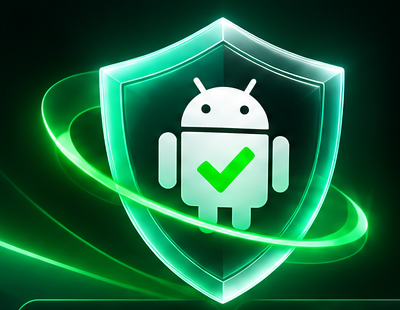
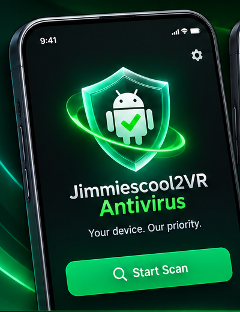
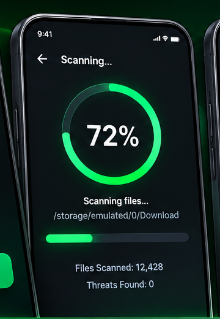
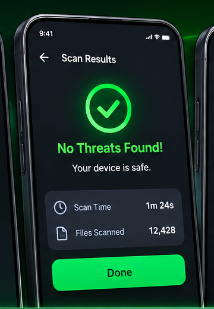
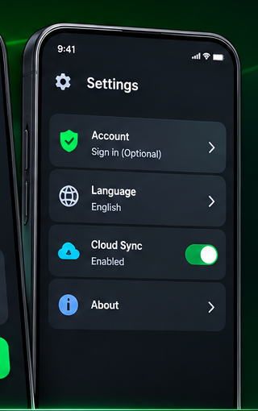

# Jimmiescool2VR Antivirus

  

> An independent, open-source Android security project focused on making device-file checks easier to understand.

**Project status: In development.** Features described below are project goals and are not available until implemented and tested.

## Overview## App Preview

These images are design mockups showing the planned application interface.

### Home Screen

### Scanning Screen

### Scan Results

### Settings

Jimmiescool2VR Antivirus is being developed as a native Android application. Its goal is to provide an easy-to-use interface for scanning accessible files, reviewing scan results, and managing optional account preferences.

This is an independent project. It is not affiliated with Google, Android, Samsung, Microsoft, or any other company.

## Features and Project Goals

- **File Scanning:** Scan files Android makes accessible.
- **Local Processing:** Process scanned files directly on the device.
- **Guest Access:** Basic scanning without an account.
- **Optional Accounts:** Planned Google, Apple, and email sign-in.
- **Cloud Sync:** Optional synchronization with user permission.
- **Privacy First:** Scanned file contents are not uploaded.
- **Languages:** English and Romanian.
- **No Paywalls:** No subscriptions or paid upgrades planned.

## Privacy and Security

Privacy is a core project goal.

- Scanning is designed to happen locally.
- Scanned file contents are not intended to be uploaded.
- Supabase is planned for authentication and optional account features.
- Cloud synchronization should require user permission.
- Only necessary permissions should be requested.

## Android Scanning Limitations

Android restricts what ordinary applications can access.

Even with broad shared-storage permissions, an app cannot freely inspect every protected system location or another app's private internal files.

A clean scan does not guarantee that a device is completely free of malware.

## Accounts and Cloud Services

Guest use is intended to remain available for basic scanning.

Planned account features:

- Saved scan history
- Account preferences
- Optional cross-device synchronization

**Backend:** Supabase.

No paid subscription or paywall is planned.

## Technology

- **Platform:** Android
- **Application:** Native Android
- **Backend:** Supabase (planned)
- **Authentication:** Google, Apple, and email (planned)
- **License:** Apache License 2.0

## Installation

Official APK releases and installation instructions will be published when development is ready.

[View Releases](https://github.com/jimmiescool2yt/Jimmiescool2VR-Antivirus/releases)

## Contributing

Contributions, suggestions, and bug reports are welcome.

When reporting bugs, include:

- Android device model
- Android version
- Application version
- Steps to reproduce
- Relevant error messages

Never post passwords, authentication tokens, or private keys.

## Security

Security is an ongoing development priority.

Please avoid publicly posting sensitive vulnerability details. A private security-reporting process will be documented when established.

## Contact

- **Project:** Jimmiescool2VR Antivirus
- **Developer:** Jimmiescool2VR
- **Email:** Jimmiescool2yt@gmail.com
- **GitHub:** https://github.com/jimmiescool2yt/Jimmiescool2VR-Antivirus

## License

Licensed under the [Apache License 2.0](LICENSE).

---

**Jimmiescool2VR Antivirus — Independent. Open Source. Privacy Focused.**
